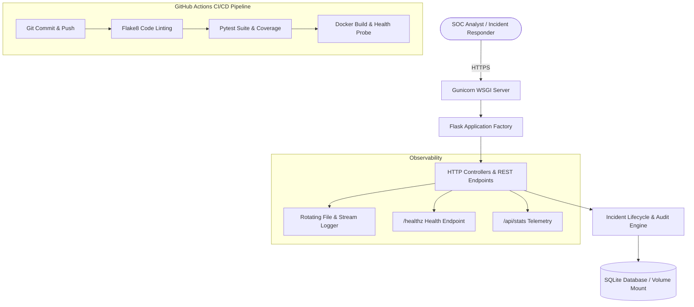

# Security Incident Case Management System — Python & DevOps

[](https://github.com/your-org/security-incident-system/actions)
[](https://www.python.org/)
[](https://flask.palletsprojects.com/)
[](https://www.docker.com/)
[](https://pytest.org/)
[](LICENSE)

A production-grade, web-based Security Operations Center (SOC) incident response and case management platform built with **Python 3**, **Flask**, **SQLite**, and **Bootstrap 5**, integrated with genuine **DevOps practices** across the software development lifecycle (SDLC).

Designed as a demonstrable college capstone engineering project illustrating containerization, CI/CD automation, testing, structured logging, and cloud readiness.

---

## 1. System Architecture



---

## 2. Key Features

### Security Operations Dashboard
- **Executive KPI Cards:** Real-time counters for Total Incidents, Active Open Cases, Investigating, and Remediated/Resolved cases.
- **Threat Telemetry Visualizations:** Interactive Chart.js charts breaking down cases by **Severity** (Critical, High, Medium, Low) and **Threat Category**.
- **Critical Alert Banner:** Dynamic alert triggered when active Critical-severity incidents require urgent triage.
- **Live SOC Clock:** UTC operations clock synchronized in the top header.
- **Recent Incident Activity:** Quick-access table displaying the latest reported security cases.

### Comprehensive Incident Lifecycle Management
- **Create & Report Cases:** Record title, threat category, severity level, affected asset/hostname, reporter, initial assignee, and detailed Indicators of Compromise (IoCs).
- **Incident Dossier:** Individual case view detailing timeline, asset scope, and full case metadata.
- **Workflow State Transitions:** Track incidents through standard incident response stages:
  $$\text{Open} \longrightarrow \text{Investigating} \longrightarrow \text{Mitigated} \longrightarrow \text{Resolved} \longrightarrow \text{Closed}$$
- **Analyst Investigation Notes:** Incident responders can append chronological investigation findings, evidence hashes, and containment notes.
- **Immutable Audit Trail:** Automated activity logging recording every status change, reassignment, edit, and note creation with operator attribution and UTC timestamp.
- **Update & Delete:** Modify case details or delete cases with confirmation modals.

### Search, Multi-Filter & Export
- **Full-Text Search:** Search across Case IDs (e.g., `INC-2026-0001`), titles, affected hostnames, assignees, or descriptions.
- **Multi-Filter Engine:** Filter simultaneously by Severity, Status, and Threat Category.
- **Sort Options:** Order cases by Newest, Oldest, or Severity (Critical down to Low).
- **CSV Data Export:** One-click export of complete incident case records for compliance and external reporting.

---

## 3. DevOps Implementation

| DevOps Practice | Implementation Details |
| :--- | :--- |
| **Version Control** | Standard Git repository structure with comprehensive `.gitignore` for Python, virtual environments, SQLite, logs, and IDE caches. |
| **Containerization** | Production-grade `Dockerfile` using lightweight `python:3.11-slim`, running under an unprivileged user (`appuser`, UID 10001) with built-in Docker `HEALTHCHECK`. |
| **Container Orchestration** | `docker-compose.yml` defining port forwarding (`5000:5000`), healthcheck intervals, and volume mounts (`./instance:/app/instance`, `./logs:/app/logs`) for persistent database storage and log shipping. |
| **CI/CD Automation** | GitHub Actions workflow (`.github/workflows/ci.yml`) triggering on pushes and pull requests to validate code quality (`flake8`), run automated tests (`pytest`), generate coverage XML, and build & verify the Docker container. |
| **Automated Testing** | Comprehensive Pytest suite (`tests/`) testing models, routes, form validations, search queries, CSV export, and DevOps endpoints using isolated in-memory SQLite instances. |
| **Logging & Monitoring** | Python `RotatingFileHandler` writing structured logs to `logs/app.log` (5MB rotation, 5 backups) plus stdout stream logging; container-ready `/healthz` health check endpoint verifying database connectivity. |
| **Cloud Deployment** | `Procfile` and environment variable architecture ready for one-click deployment on platforms such as Render, Railway, Heroku, AWS EC2, or Azure App Service. |

---

## 4. Project Directory Structure

```
DevOPSs projectt/
├── .github/
│   └── workflows/
│       └── ci.yml               # GitHub Actions CI/CD automated workflow
├── app/
│   ├── __init__.py              # Flask app factory, logging & error handlers
│   ├── models.py                # SQLAlchemy models (Incident, Note, AuditLog)
│   ├── routes.py                # Web routes & REST API endpoints
│   ├── utils.py                 # Incident numbering, CSV export, seed helpers
│   ├── static/
│   │   ├── css/
│   │   │   └── style.css        # Dark cybersecurity SOC theme
│   │   └── js/
│   │       └── dashboard.js     # Chart.js charts & live UTC clock
│   └── templates/
│       ├── base.html            # Main responsive layout with sidebar
│       ├── dashboard.html       # KPI metrics, charts & recent cases
│       ├── incidents.html       # Registry with search & multi-filtering
│       ├── incident_detail.html # Case dossier, notes, timeline & audit log
│       ├── incident_form.html   # Report & edit incident form
│       └── errors/
│           ├── 404.html         # Custom SOC-themed 404 page
│           └── 500.html         # Custom SOC-themed 500 page
├── instance/
│   └── .gitkeep                 # Local SQLite storage (gitignored)
├── logs/                        # Application log directory (gitignored)
├── tests/
│   ├── __init__.py              # Tests package initializer
│   ├── conftest.py              # Pytest fixtures (in-memory SQLite & client)
│   ├── test_models.py           # Unit tests for data models & relationships
│   ├── test_routes.py           # Route & lifecycle integration tests
│   └── test_health.py           # DevOps healthcheck & error handler tests
├── .dockerignore                # Exclusions for Docker build context
├── .gitignore                   # Exclusions for Git version control
├── Dockerfile                   # Hardened, non-root Docker build specification
├── docker-compose.yml           # Multi-container orchestration & persistence
├── Procfile                     # Deployment entrypoint for PaaS platforms
├── requirements.txt             # Production runtime dependencies
├── requirements-dev.txt         # Development, testing & linting dependencies
├── run.py                       # Main application entrypoint
├── seed.py                      # Standalone CLI demo database seeder
└── README.md                    # Project documentation
```

---

## 5. Local Setup & Execution

### Prerequisites
- Python 3.10+ installed
- Git installed

### 1. Clone & Navigate to Repository
```bash
git clone https://github.com/your-username/security-incident-system.git
cd security-incident-system
```

### 2. Create and Activate Virtual Environment
- **On Windows (PowerShell):**
  ```powershell
  python -m venv venv
  .\venv\Scripts\Activate.ps1
  ```
- **On Linux / macOS:**
  ```bash
  python3 -m venv venv
  source venv/bin/activate
  ```

### 3. Install Dependencies
```bash
pip install --upgrade pip
pip install -r requirements-dev.txt
```

### 4. Run the Application
```bash
python run.py
```
Open your browser and navigate to:
```
http://127.0.0.1:5000
```
> [!NOTE]
> On first startup, the application automatically initializes the SQLite database and seeds 8 realistic cybersecurity incident cases with investigation notes and audit timelines for immediate demonstration.

---

## 6. Docker & Docker Compose Setup

### Option A: Using Docker Compose (Recommended)
Build and run the containerized application with persistent volume mounts:
```bash
docker compose up --build
```
To run in the background (detached mode):
```bash
docker compose up -d
```
To view real-time logs:
```bash
docker compose logs -f
```
To stop the application:
```bash
docker compose down
```

### Option B: Using Standalone Docker
1. Build the Docker image:
   ```bash
   docker build -t security-incident-system:latest .
   ```
2. Run the container:
   ```bash
   docker run -d -p 5000:5000 \
     -v "$(pwd)/instance:/app/instance" \
     -v "$(pwd)/logs:/app/logs" \
     --name soc_app \
     security-incident-system:latest
   ```
3. Test container health:
   ```bash
   curl http://localhost:5000/healthz
   ```

---

## 7. Automated Testing & Code Quality

### Running Unit & Integration Tests
Execute the Pytest test suite with verbose output:
```bash
pytest tests/ -v
```

### Running with Code Coverage
```bash
pytest tests/ -v --cov=app --cov-report=term-missing
```

### Code Style & Linting Check
```bash
flake8 app/ tests/ --count --max-line-length=120 --statistics
```

---

## 8. Continuous Integration (CI/CD Pipeline)

The project includes an enterprise-grade GitHub Actions workflow in `.github/workflows/ci.yml`.

Whenever code is pushed or a pull request is opened on `main` or `master`, the pipeline automatically executes three sequential jobs:

1. **Lint Job:**
   - Checks Python syntax and enforces PEP8 standards using `flake8`.
2. **Test Job:**
   - Installs runtime and development dependencies.
   - Executes `pytest` with coverage measurement.
   - Generates and uploads `coverage.xml` as a build artifact.
3. **Docker Build & Health Probe:**
   - Sets up Docker Buildx.
   - Builds the production image using `Dockerfile`.
   - Spins up a test container and probes `http://localhost:5000/healthz`.
   - Verifies that the container boots and responds with `200 OK`.

---

## 9. Cloud Deployment Guide

### Deploying to Render
1. Create a free account at [render.com](https://render.com).
2. Connect your GitHub repository.
3. Select **Web Service**.
4. Configure the service settings:
   - **Environment:** `Python 3` (or `Docker`)
   - **Build Command:** `pip install -r requirements.txt`
   - **Start Command:** `gunicorn "run:app" --bind 0.0.0.0:$PORT --workers 2 --threads 4`
5. Add Environment Variables:
   - `FLASK_ENV`: `production`
   - `SECRET_KEY`: `<generate-a-random-secret-key>`
6. Click **Deploy Web Service**.

### Deploying with Docker to AWS EC2 / DigitalOcean Droplet
1. Launch an Ubuntu Linux virtual machine.
2. Install Docker and Docker Compose:
   ```bash
   sudo apt-get update
   sudo apt-get install -y docker.io docker-compose
   ```
3. Clone your repository:
   ```bash
   git clone https://github.com/your-username/security-incident-system.git
   cd security-incident-system
   ```
4. Start the service with Docker Compose:
   ```bash
   sudo docker-compose up -d --build
   ```
5. Allow traffic on port `5000` or configure an Nginx reverse proxy with SSL (`certbot`).

---

## 10. Sample Seed Incident Cases

The database contains pre-configured realistic SOC cases demonstrating various attack vectors:

- **INC-2026-0001:** Credential Stuffing Attack Detected on Auth Gateway *(Critical, Unauthorized Access)*
- **INC-2026-0002:** Spear Phishing Email Campaign with Macro-Enabled Attachment *(High, Phishing)*
- **INC-2026-0003:** Ransomware Binary Flagged by EDR on File Server FS-02 *(Critical, Ransomware)*
- **INC-2026-0004:** Layer 7 HTTP Flood against Public REST API *(High, DDoS)*
- **INC-2026-0005:** S3 Cloud Bucket Accidentally Configured with Public Read *(Medium, Policy Violation)*
- **INC-2026-0006:** Suspicious Privilege Escalation on Kubernetes Worker Node *(High, Privilege Escalation)*
- **INC-2026-0007:** Suspected Rogue Wi-Fi Access Point in Building B *(Low, Unauthorized Access)*
- **INC-2026-0008:** SQL Injection Probe Attempt on Marketing Web Portal *(Low, Vulnerability Exploit)*

To re-seed or reset sample cases at any time:
```bash
python seed.py --force
```

---

## 11. Academic Evaluation Summary

This project demonstrates proficiency across the core pillars of modern Software Engineering and DevOps:

- **Backend Engineering:** Python application factory pattern, modular Blueprint architecture, database schema design, and relational integrity with cascade deletes.
- **Frontend & UI/UX:** Responsive cybersecurity SOC console with real-time Chart.js telemetry, intuitive filtering, and accessibility.
- **DevOps Culture:** Containerization using Docker security best practices (unprivileged `appuser`), Docker Compose service orchestration, automated CI/CD with GitHub Actions, structured rotating logging, and health checking (`/healthz`).
- **Software Quality Assurance:** Automated testing covering unit, integration, and HTTP lifecycle paths with Pytest.
# DevOPSs-projectt

